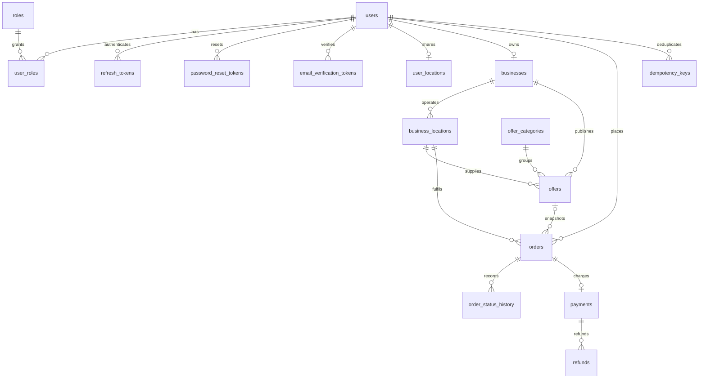

# Database contract (WAS-56)

Platform owner: Rari (P). Feature owners request schema changes in a Jira task assigned to P; only P authors migrations. Team review is required before merging.

## Conventions and delivery

snake_case; UUID primary keys default to gen_random_uuid(); timestamptz UTC; money numeric(10,2), EUR currency char(3); created_at/updated_at; optimistic version bigint on mutable aggregates. JPA entities use ddl-auto=validate. Services update updated_at through auditing; direct SQL writers must set it explicitly.

One linear stream in src/main/resources/db/migration: V1 identity, V2 catalog, V3 ordering/payments, V4 geo/text indexes, V5 order indexes. Ticket version ranges are planning guidance; actual files use consecutive delivery order. Never edit an applied migration, including during review after deployment: add a forward fix. CI rejects changes/deletions to migrations present in its base commit. Expand/contract destructive changes across releases.

Users, businesses and offers are soft deleted by setting deleted_at (and appropriate status); normal queries must exclude them. Soft deletion does not null orders.offer_id; order snapshots remain authoritative. Hard offer deletion sets offer_id to null. Financial records use restrictive foreign keys and are never cascade deleted. Identity tokens cascade only on hard user deletion. P18 implements anonymization later.

All FK and CHECK constraints are named; referencing columns are indexed. Composite foreign keys enforce that offer/order locations belong to the stated business, stronger than the service-only check originally proposed in WAS-58. Amounts and quantities are constrained, email uniqueness is case insensitive. Application services still enforce state transitions, refund totals and offer/business ownership.

PostGIS location is a generated stored geography point from coordinates; it cannot drift. GIST and pg_trgm GIN indexes support ST_DWithin and ILIKE. Time-sensitive filters use ordinary composite indexes rather than invalid partial indexes containing now(). Query-plan/performance targets require the later P22/P24 benchmark dataset; this change does not claim those targets.

## Team handoff

A maps users/roles/tokens (V1); B maps catalog (V2/V4); C maps orders/payments (V3/V5). Review this ERD and API contract before mapping repositories. Entities are owned by feature teams; this foundation creates no duplicate entities. No demo seed is included in production migrations. P15/P16 should use a separate dev-only Flyway location, never prod.

Tests: PlatformIT starts an empty PostgreSQL 16/PostGIS database, applies all migrations and validates checksums, case-insensitive uniqueness and HTTP access boundaries. CI runs it with Docker. Entity drift coverage grows as feature teams add entities; no feature entity exists yet.
